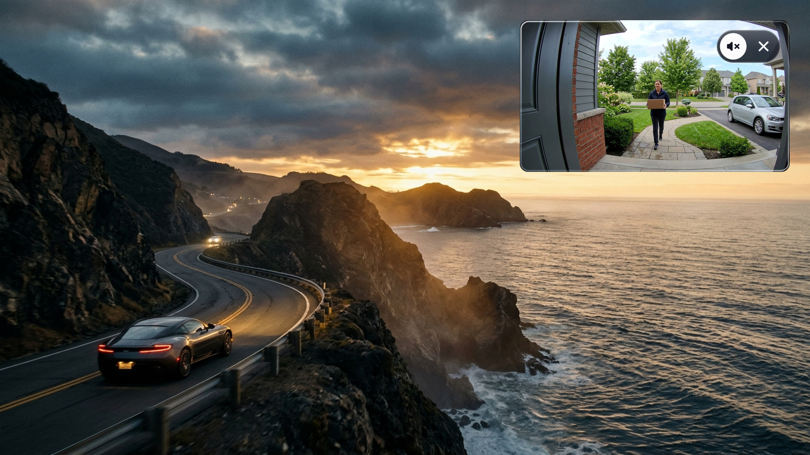
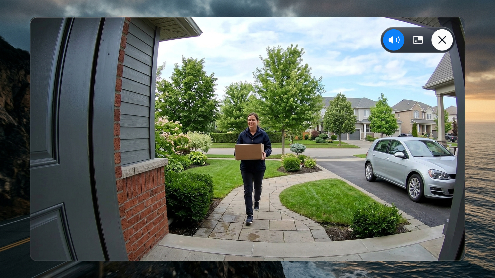
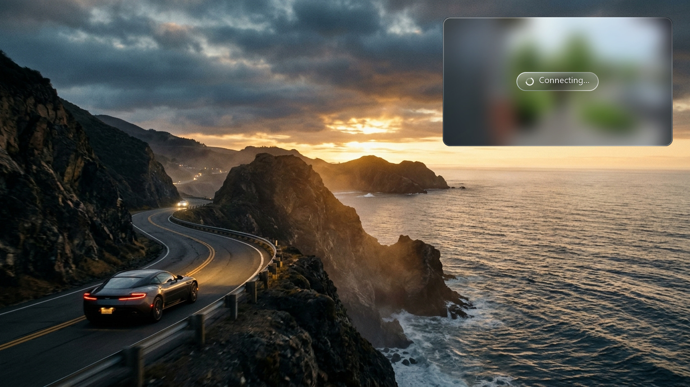

# Ring Shield Overlay

Ultra-low-latency, Apple tvOS-style **Ring Video Doorbell** live picture-in-picture and fullscreen overlay for **Nvidia Shield Pro (Android TV)**.

Built on the **Official Ring Partner API (WebRTC WHEP + Webhooks)**, a lightweight 24/7 **Node.js/TypeScript LAN relay** (tested on Raspberry Pi + Cloudflare Tunnel) with a built-in **local Alexa Hue Bridge**, and a native **Kotlin + `stream-webrtc-android` (`arm64-v8a`)** Android TV overlay service.

<p align="center">
  
  <br />
  <em>Corner PiP overlay with the dark smoked-glass <code>[ Audio | ✕ ]</code> control dock floating over full-screen playback (illustrative example feed).</em>
</p>

---

## Screenshots

| Fullscreen View & Live Audio Controls | Frosted Liquid Glass Connecting Screen |
| :---: | :---: |
|  |  |
| **88% Fullscreen** with active Apple Blue (`#0A84FF`) soundwave badge, PiP minimize, and default `✕` focus for 1-click dismiss. | **Instant Visual Feedback** using a fast 3-pass blurred preview of the last doorbell frame while WebRTC connects. |

---

## Features

- **Direct WebRTC (Ring ↔ Shield Pro):** Uses the official Ring Partner WHEP endpoint with zero transcoding, zero RTSP/HLS hops, and hardware H.264 decoding (`OMX.Nvidia.h264.decode`).
- **4K Dolby Vision & HDR Safe:** `TextureView`-backed WebRTC renderer (`TextureViewRenderer` on `org.webrtc.EglRenderer`) composites cleanly over **4K Dolby Vision Profile 7**, HDR10, Netflix, YouTube, and Live TV without HDMI mode switches or transparent surface punch-through.
- **Motion-Triggered Pipeline Pre-Warming (`MOTION_PREWARM`):** On `motion_detected`, the Shield locally pre-creates its `PeerConnection` and finishes STUN ICE gathering with **zero extra doorbell wake-ups or battery drain**. When `button_press` arrives, the ready SDP offer posts to WHEP in `<1 ms`.
- **Apple tvOS-Style Smoked-Glass Control Dock:**
  - High-contrast dark smoked-glass capsule (`[ Audio | ✕ ]` in PiP, `[ Audio | PiP | ✕ ]` in Fullscreen) readable over bright daytime skies and night scenes alike.
  - Smooth sliding focus pill with subtle horizontal glide stretch and tactile press bounce.
  - Animated muted-speaker (`×`) → cascading soundwaves + Apple Blue (`#0A84FF`) active badge morph.
- **Zero-Interruption Audio & Smart Media Control:**
  - Starts **muted** so foreground playback is never interrupted when someone rings or walks past.
  - Unmuting cleanly **pauses** VOD players (and silently mutes Live TV apps via per-package ADB `appops PLAY_AUDIO`), then automatically resumes/unmutes when muted or dismissed.
- **Zero-Crop GPU Watermark Erasure (`< 0.4 ms/frame`):** Custom OpenGL ES 2.0 `WatermarkInpaintDrawer` using a compressed 4-direction boundary LUT and adaptive 9-slope stroke inpainter to cleanly remove Ring Partner API corner watermarks with `0%` frame crop.
- **Built-In Local Amazon Alexa Integration (No Cloud Skill Required):** The relay runs a local Philips Hue Bridge v1 emulator (port `80` + UPnP SSDP) exposing **Front Door View** (PiP) and **Front Door Fullscreen** directly to Echo devices on your LAN with two-way WebSocket state sync.
- **24/7 Home Server / Raspberry Pi Ready:** Auto-refreshing Ring OAuth tokens, LAN-only endpoint enforcement (Cloudflare Tunnel only exposes `/api/webhook` publicly), and automatic LAN WebSocket reconnect + WHEP retry hardening.

---

## Architecture

```text
Ring Doorbell (1080p H.264)
        │
        ▼
Ring Cloud / Amazon Vision API (api.amazonvision.com)
   ├─ Webhooks (button_press / motion_detected) ──► Cloudflare Tunnel ──► Home Server / Pi Relay ──(LAN WS <1 ms)──► Shield Pro
   ├─ WHEP SDP Offer/Answer                     ◄── Direct WAN ────────── Home Server / Pi Relay ◄─(LAN HTTP <1 ms)─ Shield Pro
   └─ Live Video + Audio (WebRTC SRTP)          ═══════════════════════ Direct Ring ↔ Shield Pro ═════════════════► TextureView Overlay

Amazon Echo (LAN) ──(Local Hue Bridge v1, port 80)──► Home Server / Pi Relay ──(LAN WS <1 ms)──► Shield Pro (PiP / Fullscreen / Dismiss)
```

> See [docs/feasibility-assessment.md](docs/feasibility-assessment.md) for the deep-dive technical feasibility study and latency budget, and [docs/ring-portal-setup.md](docs/ring-portal-setup.md) for Ring Developer Portal setup.

---

## Remote Controls (Shield TV D-Pad)

| Mode | Button | Action |
| --- | --- | --- |
| **Corner PiP** | First D-Pad tap | Reveals the `[ Audio | ✕ ]` dock & highlights the PiP card |
| **Corner PiP** | `OK` (on card) | Smoothly morphs into **88% Fullscreen** |
| **Corner PiP** | `Left` / `Right` + `OK` | Toggles doorbell audio or dismisses |
| **Corner PiP** | `Back` | Dismisses immediately |
| **Fullscreen** | `OK` (default focus) | Dismisses immediately (1-click exit when opened via Alexa) |
| **Fullscreen** | `Left` / `Right` + `OK` | Toggles live doorbell audio, shrinks back to PiP, or dismisses |
| **Fullscreen** | `Back` | Shrinks back to PiP (or dismisses) |

---

## Quick Start

### 1. Configure & Run the Relay (Raspberry Pi / Linux / Windows)

Follow [docs/ring-portal-setup.md](docs/ring-portal-setup.md) to create a Ring Private Use App (or grab a temporary Playground token):

```bash
cd relay
cp .env.example .env
# Edit .env with your Ring OAuth credentials, LAN_TOKEN, and optional SHIELD_ADB_SERIAL
npm ci
npm run build
npm test
npm start
```

Verify the relay health and device discovery on your LAN:

```bash
curl http://<RELAY_IP>:8787/health
curl -H "Authorization: Bearer <LAN_TOKEN>" http://<RELAY_IP>:8787/api/devices
```

*(Optional — Alexa voice control)*: Run the relay with port `80` capability (e.g. `AmbientCapabilities=CAP_NET_BIND_SERVICE` in `systemd`), say **"Alexa, discover my devices"**, and add an Alexa Routine (for example *"Alexa, show me the front door"* → turn on **Front Door Fullscreen**).

### 2. Build the Shield Pro APK (`arm64-v8a`)

GitHub Actions automatically builds `app-debug.apk` on every push (see `.github/workflows/`), or build locally with Docker (no local JDK/Android SDK needed):

```bash
docker build -f android-poc/Dockerfile.build -t ring-shield-builder android-poc
docker run --rm -v "${PWD}/android-poc/out:/out" ring-shield-builder
```

### 3. Sideload & Configure on Nvidia Shield Pro

```bash
adb connect <SHIELD_IP>:5555
adb install -r android-poc/out/app-debug.apk
adb shell appops set com.builtbymac.ringshield SYSTEM_ALERT_WINDOW allow
adb shell appops set com.builtbymac.ringshield GET_USAGE_STATS allow
adb shell dumpsys deviceidle whitelist +com.builtbymac.ringshield
```

Push `/sdcard/Android/data/com.builtbymac.ringshield/files/config.json`:

```json
{
  "relayUrl": "http://<RELAY_IP>:8787",
  "lanToken": "<LAN_TOKEN>",
  "deviceId": "<DEVICE_ID>",
  "mode": "MOTION_PREWARM",
  "corner": "TOP_RIGHT",
  "overlayDurationSec": 20,
  "overlayWidthPx": 640,
  "overlayHeightPx": 360,
  "softwareDecoder": false,
  "stripTwcc": false,
  "includeAudioTransceiver": true,
  "iceGatherBudgetMs": 1500,
  "prewarmTtlMs": 45000,
  "minPlayoutDelayMs": 200,
  "cropRingWatermark": true,
  "showLiveDot": false,
  "showCountdownBar": false
}
```

Start the background service silently without interrupting playback, then test an overlay trigger:

```bash
adb shell am broadcast -a com.builtbymac.ringshield.ACTION_DISMISS \
  -n com.builtbymac.ringshield/.RemoteCommandReceiver

curl -X POST http://<RELAY_IP>:8787/api/overlay/command \
  -H "Authorization: Bearer <LAN_TOKEN>" \
  -H "Content-Type: application/json" \
  -d '{"action": "show"}'
```
