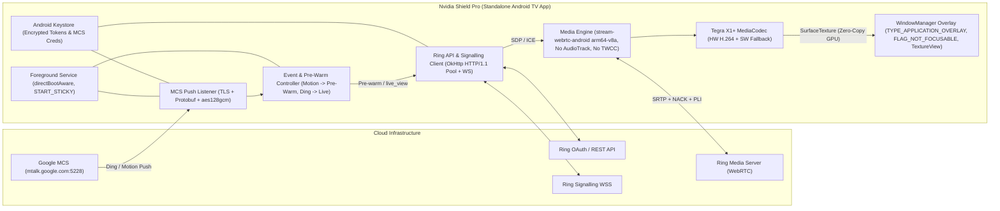

# Technical Feasibility Assessment: Ultra-Low-Latency Ring Doorbell Overlay for Nvidia Shield Pro

> [!IMPORTANT]
> **Executive Verdict:** A standalone, root-free Android TV application running entirely on the Nvidia Shield Pro that displays a live Ring doorbell video overlay over running apps—without pausing playback—is **technically feasible**, with **no external server required**, using Ring's unofficial Android/WebRTC APIs and a direct Google MCS push receiver.
>
> However, **sub-1-second end-to-end latency from physical button press** faces hard cloud and camera-wake physics (~0.4–1.0 s on wired doorbells, ~1.5–4.0+ s on sleeping battery doorbells *before* the Shield even receives the push event). Furthermore, **full motion-triggered pre-emptive streaming carries a critical functional blocker** (active Live View can suppress physical doorbell button presses/chimes, illuminates the blue LED, creates spurious cloud recordings, and drains battery). Instead, we identify a **zero-side-effect "Motion-Triggered Pipeline Pre-Warming"** strategy that captures most of the speed benefit without opening a camera stream prematurely.

---

## 1. Source-Code Analysis of Referenced Projects & Official Platform

All six referenced repositories (including `ring-mqtt`'s `dev` v6 branch with Go `ringstream` and its wiki) were cloned and inspected at the source level, alongside the official Ring Developer documentation.

### 1.1 `dgreif/ring` (`packages/ring-client-api`)

| Area | Source-Verified Implementation Details | Key Takeaways for Our App |
| :--- | :--- | :--- |
| **Authentication** (`rest-client.ts`) | `POST https://oauth.ring.com/oauth/token` using `client_id: "ring_official_android"`, `User-Agent: "android:com.ringapp"`, and a stable `hardware_id`. Rotating refresh tokens are stored as a Base64 JSON bundle `{ rt, hid, pnc }`. Access tokens are proactively cleared 60 s before expiry. | Must persist rotated refresh tokens atomically and keep `hardware_id` constant across restarts. |
| **Session Residency** (`rest-client.ts:506-523`) | Calls `POST clients_api/session` and explicitly refreshes it **every 12 hours** because Ring evicts inactive sessions after ~24 h for non-US accounts (data residency), silently breaking push notifications. | Mandatory 12-hour session keep-alive timer in our background service. |
| **Event Delivery** (`api.ts:234-395`, `ring-camera.ts:218-240`) | **Ring does NOT push doorbell/camera events over a Ring WebSocket** (`location.ts` WebSocket is strictly for Alarm base stations and Beam bridges). Instead, `ring-client-api` uses `@eneris/push-receiver` to hold a persistent TLS/protobuf **Google MCS connection (`mtalk.google.com:5228`)**, impersonating Ring's Android Firebase app (`projectId: ring-17770`, `messagingSenderId: 876313859327`, `appId: 1:876313859327:android:e10ec6ddb3c81f39`). The FCM token is registered via `PATCH clients_api/device` (`pn_service: "fcm"`, `os: "android"`), and each doorbell is subscribed via `POST doorbots/{id}/subscribe` and `motions_subscribe`. | Our standalone Shield app **cannot** use Google Play Services' `FirebaseMessaging` SDK for Ring's Firebase project (package name & signing cert mismatch). It **must** speak the FID + GCM Checkin + MCS (`mtalk.google.com:5228`) + RFC 8291 (`aes128gcm`) protocol directly. |
| **Push Payload Schema** (`ring-types.ts:1038-1090`) | `PushNotificationDingV2` delivers `android_config.category` (`com.ring.pn.live-event.ding` / `.motion`), **`analytics.triggered_at` & `analytics.sent_at`** (server timestamps!), `data.device.e2ee_enabled`, `data.event.ding.detection_type` (`human`, etc.), `data.event.live_session` (`active_streaming_profile: "rms"`), and `img.snapshot_uuid`. | `triggered_at` / `sent_at` enable exact cloud-vs-client latency decomposition in our PoC. `e2ee_enabled` flags incompatible encrypted cameras. `snapshot_uuid` enables an instant poster frame while WebRTC connects. |
| **WebRTC Signalling** (`webrtc-connection.ts`, `simple-webrtc-session.ts`) | Two paths exist: **(1) Full Trickle-ICE WebSocket** (`POST prd-api-us.prd.rings.solutions/api/v1/clap/ticket/request/signalsocket` → `wss://api.prod.signalling.ring.devices.a2z.com:443/ws?api_version=4.0&auth_type=ring_solutions&client_id=ring_site-<uuid>&token=<ticket>`, `User-Agent` header mandatory or socket closes immediately). Sends `live_view` with SDP offer, trickles `ice`, sends `activate_session` (required to exceed 70 s) + `stream_options`, plus 5 s `ping` keepalive (for Ring Edge). Uses `bundlePolicy: "disable"` and KVS/Google STUN. **(2) `SimpleWebRtcSession`** (`POST integrations/v1/liveview/start`): single HTTP offer/answer, no trickle ICE, and activates camera speaker on Ring Edge (draining battery). | Use the **WebSocket trickle-ICE path**—it avoids waiting for full ICE gathering before sending the offer, supports Ring Edge cleanly, and keeps the camera speaker muted. |

### 1.2 `tsightler/ring-mqtt` (`main` v5.9.3, `dev` v6.x Go `ringstream`, and Wiki)

Inspecting the **`dev` branch (`ringstream/` in Go 1.25 + Pion WebRTC v4 + `gortsplib` v5)** uncovered several critical, production-tested Ring streaming behaviours that do not appear in READMEs:

1. **Pre-Roll Backlog Drain (`ringstream/main.go:398-438`, `README.md`)**: When a doorbell live session opens, Ring blasts **several seconds of pre-roll backlog at line rate**. Feeding that burst straight into a decoder causes playback to start seconds in the past or stall the decoder. `ringstream` drains the backlog (using a 20 ms inter-packet read timeout once parameter sets are seen) and re-anchors on the **newest** complete keyframe run.
2. **In-Band Parameter Sets (`ringstream/params.go`)**: Ring sends H.264 SPS/PPS or HEVC VPS/SPS/PPS only in-band alongside keyframes, flagging each NAL individually as a random access point. Starting mid-run yields undecodable frames until the next ~2 s GOP.
3. **RTCP PLI Keyframe Acceleration (`ringstream/main.go:356-367, 623-644`)**: Ring's default GOP interval is ~2 seconds. Sending an immediate **RTCP Picture Loss Indication (PLI)** at stream start (and retrying every 200–300 ms *only* until the first keyframe arrives) cuts time-to-first-frame significantly without triggering a redundant second IDR burst.
4. **TWCC Startup Probe Trap (`ringstream/main.go:106-116`)**: Advertising `transport-cc` in SDP is fine, but **actually sending TWCC feedback causes Ring's send-side bandwidth estimator to probe resolutions up and down during the first few seconds**, forcing hardware decoders to repeatedly tear down and re-initialize! Sending plain RTCP Receiver Reports + NACK/RTX holds a steady resolution.
5. **Native H.265 / HEVC vs Server Transcoding (`ringstream/main.go:66-79`, `camera.js:25,749-751`)**: Ring answers strictly within the codecs in the SDP offer. Offering H.264-only forces Ring's servers to transcode streams from modern HEVC-native cameras (`settings.video_settings.hevc_enabled == true`), adding slight server latency and lowering quality. Offering H.265 delivers native 2K/4K without cloud transcoding (though H.265 decoders lock up on partial slices—requiring strict complete access-unit assembly and PLI resync as implemented in `ringstream/resync.go`).
6. **Newer Ring Unofficial API Migrations (`dev/lib/ring-client/rest-client.js`, `api.js`)**:
   - Migrated login to Ring's **OAuth2 Authorization Code + PKCE** flow (`/oauth/v2/authorize` + `/oauth/v2/2fa/verify` + `/oauth/token`), alongside `refresh_token` grant.
   - Migrated discovery/events to newer v3 endpoints (`device_info/v3/devices`, `location_info/v3/locations`, `evm/v3/history/devices`), `pn_dict_version: "2.4.0"`, and explicitly sets `allowH2: false` to avoid CloudFront/Ring `NGHTTP2_ENHANCE_YOUR_CALM` disconnects.
   - Confirms motion notifications often omit `data.event.ding.id`, requiring fallback to `analytics.server_correlation_id ?? riid`.
7. **Hard Ring Platform Constraints (`FAQ.md`, `Video-Streaming.md`)**:
   - **Zero local-network streaming**: Even Ring Edge (Alarm Pro local storage) routes signalling through Ring's cloud and exposes no local RTSP/WebRTC endpoint.
   - **No motion detection while streaming**: Cameras suppress motion events during active live views/recordings.
   - **Every live stream creates a recording** on Ring Protect accounts, and Ring forcefully terminates live sessions after ~10 minutes.
   - **"Low-power" includes trickle-charged and entry-level wired doorbells** (e.g., *Video Doorbell Wired*), not just pure battery models.

### 1.3 `ryanmab/ring-client` (Rust Crate `v0.1.3`)

- **Status:** Explicitly marked `maintenance = { status = "passively-maintained" }` in `Cargo.toml`.
- **Capabilities Verified in Source:** Implements basic password/refresh OAuth (`authentication/mod.rs`), device listing for only 3 hardcoded `kind` variants (`CocoaCamera`, `DoorbellGrahamCracker`, `BaseStationV1`, `device.rs`), and `location::Listener` (`location/event.rs`) over Ring's Alarm/Location AppSocket (`clap/tickets`).
- **Missing Everything Required for This Project:**
  - **No FCM/MCS push receiver** (cannot receive doorbell `ding` or camera `motion` notifications).
  - **No WebRTC / camera streaming** (`src/lib.rs:169` lists video streaming as an unimplemented future contribution).
  - **Auth gaps:** `refresh_tokens()` (`authentication/mod.rs:174`) hardcodes `client_id: "ring_official_ios"`, omits `hardware_id`, lacks PKCE login, and does not persist rotated refresh tokens.
- **Verdict:** **Not suitable as a dependency or starting point.** If Rust is used, write a clean, focused client modeled directly on `dgreif/ring` and `ring-mqtt` v6.

### 1.4 `stevenflesch/ring-to-android-tv`

- **Source (`app.js`, `package.json`):** Archived 256-line Node.js script using `ring-client-api` v11.2.1 with `cameraDingsPollingSeconds: 5` (deprecated/removed in modern Ring API) and the deprecated `request` library. On `onNewDing`, it fetches a JPEG snapshot (`camera.getSnapshot()`), writes `snapshot.png` to disk, and POSTs multipart form data to PiPup (`http://<tv>:7979/notify`).
- **Verdict:** Obsolete architecture (5 s polling + disk I/O + still JPEG + external host). Only validates that PiPup's corner overlay UX works well on Nvidia Shield.

### 1.5 `mhoogenbosch/PiPup` (Active Fork `1.0.0-beta.1`) & `mhoogenbosch/ha-pipup`

Inspecting the actual Kotlin source of `PiPup` revealed **five indispensable Android TV / Shield engineering solutions** we should reuse directly in our design:

1. **`TextureView` Over `SurfaceView` (`PopupView.kt:462-479`)**: Stock `VideoView` / `SurfaceView` allocates a separate SurfaceFlinger hardware overlay plane. When Netflix, Plex, or another media app already owns that plane, a `SurfaceView` overlay renders as a **transparent hole** showing the movie underneath. `TextureView` is GPU-composited via OpenGL directly into the overlay window and reliably renders on top of playing video.
2. **Never Open an `AudioTrack` by Default (`PopupView.kt:476-478, 550-555`)**: Creating an `AudioTrack` or requesting audio focus triggers HDMI audio renegotiation (interrupting Dolby Atmos / DTS-HD MA / TrueHD bitstream passthrough on Shield Pro) or pauses background media. Disabling the audio track (`muted = true`) preserves uninterrupted playback.
3. **Non-Focusable Overlay Window (`PiPupService.kt:885-908`)**: Uses `TYPE_APPLICATION_OVERLAY` (API 26+) with `FLAG_NOT_FOCUSABLE` and `PixelFormat.TRANSLUCENT` so D-pad/remote events pass straight through and the foreground streaming app never receives `onPause()`.
4. **Boot, Direct Boot, and Foreground Service Hardening (`AndroidManifest.xml`, `Receiver.kt`, `PiPupService.kt:196-239`)**: Declares `directBootAware="true"`, listens for `LOCKED_BOOT_COMPLETED`, `BOOT_COMPLETED`, and `MY_PACKAGE_REPLACED`, uses `foregroundServiceType="specialUse"`, returns `START_STICKY`, calls `startForeground()` idempotently in *both* `onCreate()` and `onStartCommand()`, and runs a 30 s watchdog to clean stale windows.
5. **Poster-First UX + Off-Main-Thread Codec Probing (`PopupView.kt:58-64, 160-176`, `DecoderChoice.kt`)**: Displays a snapshot poster immediately and fades it out over 150 ms upon `onRenderedFirstFrame()` while logging `firstFrameMs`. `DecoderChoice.prime()` probes `MediaCodecUtil` on a background thread at service startup and supports a software decoder fallback (`SOFTWARE_FIRST_SELECTOR`) for hardware decoder conflicts.

> [!NOTE]
> **Why not reuse PiPup's built-in `Whep` mode directly?** `PopupView.Whep` (`PopupView.kt:780-852, 1054-1128`) spins up an Android `WebView` hosting inline JavaScript `RTCPeerConnection` with `iceServers: []` and waits up to 1 s for ICE gathering. On Nvidia Shield, cold-instantiating Chromium `WebView` adds ~300–800 ms latency and ~80–150 MB RAM—fine for LAN Home Assistant setups, but unacceptable for an ultra-low-latency standalone app.

### 1.6 Official Ring Developer Platform & MCP Server

| Aspect | Verified Capabilities & Constraints | Impact on Standalone Shield App |
| :--- | :--- | :--- |
| **App Registration** | Supports **Private Use Apps** (no full public Appstore certification), but requires Amazon Developer account + government ID verification. Issues `client_id`, `client_secret`, and `HMAC Signature Key`. | Manageable for personal/hobbyist use, though heavier onboarding than a refresh token. |
| **Authentication** | OAuth 2.0 (`oauth.ring.com`) + Amazon Vision API (`api.amazonvision.com`), 100 TPS global partner limit. Explicitly documented as **server-to-server** from a Partner App Backend (CORS blocked client-side; `client_secret` cannot be safely embedded in a distributed APK). | Requires a backend for multi-user distribution; tolerable only for a private single-user build if hardcoded, *except* for webhooks below. |
| **Real-Time Events** | Delivered exclusively via **HTTPS Webhooks** (`button_press`, `motion_detected`) signed with HMAC-SHA256. A public Webhook URL **must** be registered and return HTTP `200`. No WebSocket or FCM push stream is offered. The only webhook-free fallback is polling the Event History API. | **Hard blocker for zero-server standalone operation.** An Android TV behind home NAT cannot receive public HTTPS webhooks without an external relay server or tunnel (e.g., Cloudflare Tunnel / AWS Lambda). |
| **Live Video** | Standard **WebRTC via WHEP** (single HTTP `POST` SDP offer → SDP answer). | Very clean protocol—no custom WebSocket signalling—if paired with an external relay. |
| **Ring MCP Server** | Remote Model Context Protocol server backed by Amazon Bedrock Knowledge Bases for AI-assisted coding (querying Ring API docs/schemas in IDEs). | **Developer documentation tool only**—not a runtime device-event or media server. |

---

## 2. Latency Analysis & Feasibility of Motion-Triggered Pre-Emptive Streaming

### 2.1 End-to-End Latency Breakdown (Estimates vs Observed Constraints)

Because we have not yet run hardware benchmarks on your specific Shield Pro and Ring model, all timings below are clearly labeled as **Measured/Observed (from prior projects & docs)** vs **Estimated (engineering bounds to validate in PoC)**.

```mermaid
sequenceDiagram
    participant Visitor as Visitor & Doorbell
    participant RingCloud as Ring Cloud / RMS
    participant FCM as Google MCS (mtalk:5228)
    participant Shield as Nvidia Shield Pro App

    Note over Visitor,Shield: Cold-Start Flow (No Prior Motion Pre-Warming)
    Visitor->>RingCloud: Physical button press + Wi-Fi wake (battery) + RMS attach
    RingCloud->>FCM: Trigger PNS Push (triggered_at -> sent_at)
    FCM->>Shield: Persistent TLS MCS frame (T1: Event Received)
    Shield->>RingCloud: POST signalsocket ticket + WSS connect + live_view SDP offer
    RingCloud-->>Shield: SDP answer + ICE candidates (T3)
    Shield<-->RingCloud: ICE connectivity + DTLS-SRTP handshake (T4)
    Shield->>RingCloud: Immediate RTCP PLI (request keyframe)
    RingCloud-->>Shield: Pre-roll burst -> drain -> latest IDR keyframe (T5/T6)
    Shield->>Shield: MediaCodec decode -> TextureView -> Overlay visible (T7)
```

| Pipeline Stage | Wired / Pro Doorbell (Always-Connected Wi-Fi) | Battery / Low-Power Doorbell (Cold Sleep) | Basis & Notes |
| :--- | :---: | :---: | :--- |
| **S1. Press → Shield Push Receipt (`T0→T1`)** | **300–900 ms** *(Est.)* | **1,500–4,000+ ms** *(Obs./Est.)* | Wired stays associated with Wi-Fi; battery must wake radio + TLS/MQTT to AWS first. Ring PNS → Google MCS → Shield adds ~150–400 ms. |
| **S2a. Ticket + Signalling WS (`T1→T2`)** | **150–350 ms** *(Est.)* | **150–350 ms** *(Est.)* | 1 REST round-trip (`signalsocket`) + 1 WSS TLS handshake. **Eliminated (~0 ms) if pre-warmed on motion.** |
| **S2b. Offer/ICE → SDP Answer (`T2→T3`)** | **200–500 ms** *(Est.)* | **200–500 ms** *(if awake from press)* / **+1–2 s** *(if camera not yet on RMS)* | Trickle ICE starts immediately; Ring Media Server (RMS) attaches to camera upload. |
| **S2c. ICE + DTLS-SRTP (`T3→T4`)** | **100–250 ms** *(Est.)* | **100–250 ms** *(Est.)* | Single STUN/DTLS exchange to AWS KVS/RMS media relay. |
| **S3. Connected → First Decoded Frame (`T4→T6`)** | **150–350 ms** *(Est. w/ PLI)* | **150–350 ms** *(Est. w/ PLI)* | Immediate RTCP PLI avoids waiting up to 2,000 ms for Ring's 2 s GOP. Pre-roll drain adds ~20–50 ms; Tegra X1+ NVDEC first IDR takes ~15–40 ms. |
| **S4. Decoded Frame → Visible Overlay (`T6→T7`)** | **16–50 ms** *(Est.)* | **16–50 ms** *(Est.)* | Pre-inflated `TextureView` in `WindowManager` (1–3 frames @ 60 Hz). |
| **Total Cold-Start (`T0→T7`)** | **~0.9–2.4 s** *(Est.)* | **~2.1–5.5+ s** *(Est.)* | Matches real-world Fire TV / Ring app behaviour (~1.5–3 s wired, 3–6+ s battery). |
| **Total w/ Motion Pre-Warming (Option B)** | **~0.7–1.4 s** *(Est.)* | **~0.9–1.7 s** *(Est.)* | Camera is *already awake & streaming to RMS* from motion; Ticket, WSS, & ICE candidates are already ready! |
| **Total w/ Full Pre-Streaming (Option A)** | **~0.35–0.95 s** *(Est.)* | **~0.45–1.05 s** *(Est.)* | Purely `T0→T1` + 16–50 ms visibility flip—**ONLY viable if button-suppression risk does not occur on target model.** |

> [!TIP]
> **Realistic Expectation on the <1 Second Target:**
> - **True <1 s from physical press to live video** is realistic on a **wired/Pro doorbell** (and achievable in the median case via **Pipeline Pre-Warming**, or consistently via **Full Pre-Streaming** *if* your model doesn't suppress button presses during Live View).
> - On a **cold-sleeping battery doorbell** with no preceding motion event, **<1 s is physically impossible** because the doorbell hardware itself takes >1.5 s just to wake its Wi-Fi radio and notify Ring's cloud.
> - **Perceived latency <1 s** can be boosted even on cold starts by displaying the `img.snapshot_uuid` rich-notification poster frame (~150–300 ms after `T1`) and cross-fading to live video on `onFirstFrameRendered`.

### 2.2 Deep Dive: Full Pre-Emptive Streaming vs Zero-Side-Effect Pipeline Pre-Warming

The brief specifically asks us to evaluate **motion-triggered pre-emptive streaming** (silently connecting WebRTC and decoding video on motion, then flipping visible on `ding`). Our source and platform research uncovered **five severe drawbacks** with naive pre-emptive streaming—and a far cleaner alternative.

| Dimension | Option A: Full Pre-Emptive Media Streaming on Motion | Option B: Pipeline Pre-Warming on Motion *(Recommended Default)* |
| :--- | :--- | :--- |
| **How it works** | On `motion`, immediately send `live_view`, complete WebRTC, and decode live frames to an offscreen/0-alpha surface for 15–20 s. On `ding`, flip overlay visible. | On `motion` (preferably `detection_type == "human"`), pre-fetch signaling ticket, pre-open signaling WS, pre-create `PeerConnection`, gather STUN ICE candidates, and warm `EglBase`—**WITHOUT sending `live_view`**. On `ding`, send `live_view` over the already-open WS in <1 ms. |
| **Doorbell Button / Chime Suppression** | **CRITICAL RISK:** Multiple Ring user/community reports document that an active Live View session can **suppress physical button `ding` events and in-home chimes** on several doorbell models. If `ding` is suppressed, the overlay never appears! *(Must test on user's hardware in PoC.)* | **Zero risk.** No Live View session is opened until the button is actually pressed. |
| **Leveraging Motion Wake-Up** | Yes—camera already awake. | **Yes!** Ring's own motion detection *already* wakes the camera and connects it to Ring Media Server (RMS) (`live_session.active_streaming_profile: "rms"`), eliminating the 2–4 s battery wake penalty for free! |
| **Visible Blue LED Ring** | **Yes**—illuminates doorbell ring LED on every motion (`stealth_mode` only mutes speaker, not LED). | **No**—no external indication to passersby. |
| **Battery & Cloud Recordings** | **Severe drain** on battery models (20–50+ motions/day × 15–20 s = 10–15+ min/day active streaming); floods Ring Protect timeline with "Live View" recordings; suppresses subsequent motion events while active. | **Zero battery impact** on the doorbell, **zero spurious cloud recordings**, **zero motion suppression**. |
| **Shield Idle/Playback Impact** | Spins up an NVDEC hardware decoder silently on every passing car—risking micro-stutter during 4K Dolby Vision playback. | **Zero NVDEC or GPU usage** unless the doorbell is actually pressed. |
| **Latency Eliminated** | Eliminates S2a + S2b + S2c + S3 (~600–1,400 ms). | Eliminates camera cold-wake (~1.5–3.5 s on battery) + S2a (~150–350 ms) + ICE gathering (~100–250 ms). Only 1 `live_view` RTT + DTLS + PLI remains (~350–700 ms). |

### 2.3 Assessment of Additional Low-Latency Optimisations

- **Persistent Event Subscriptions:** Hold a single long-lived TLS socket to `mtalk.google.com:5228` with MCS heartbeats and exponential backoff reconnect, paired with Ring's 12-hour `clients_api/session` refresh. Request Android battery optimization exemption on Shield so Doze never stalls the socket.
- **Reusing Authenticated Connections:** Keep a warm HTTP/1.1 connection pool (`ConnectionPool` / `reqwest` with `http1_only` to avoid Ring's `NGHTTP2_ENHANCE_YOUR_CALM` issue) to `api.ring.com` and `app.ring.com` / `prd-api-us.prd.rings.solutions`, and refresh OAuth tokens proactively 60 s before expiry so a doorbell press never triggers an inline OAuth round-trip.
- **Pre-Initialising Decoders & Surfaces:** Pre-initialize `EglBase`, `PeerConnectionFactory`, `DecoderChoice.prime()` (codec enumeration), and the overlay `FrameLayout` at service startup. **Do NOT hold an active `MediaCodec` decoder instance open 24/7**—Tegra X1+ NVDEC handles a single heavy 4K DV stream plus limited concurrent instances; holding an idle hardware decoder risks starving foreground streaming apps.
- **Direct WebRTC Without Intermediaries:** Terminating Ring WebRTC directly on the Shield removes `ring-mqtt` → RTSP → `go2rtc` → `WebView` hops (eliminating ~300–1,000 ms of transcoding/re-packetisation/WebView startup latency and ~350–500 MB of external Node+Go+WebView RAM).
- **Hardware-Accelerated Decoding on Nvidia Shield Pro:** Tegra X1+ natively hardware-decodes both H.264 (`OMX.Nvidia.h264.decode`, up to 4K30) and HEVC (`OMX.Nvidia.h265.decode`, up to 4K60 Main/Main10) directly into a `SurfaceTexture` backing a `TextureView` (zero CPU frame copy). Include a user-selectable software H.264 fallback (`c2.android.avc.decoder` / `OMX.google.h264.decoder`, ~10–15% CPU for 640×360 @ 15–20 fps) in case concurrent 4K Dolby Vision NVDEC contention occurs.
- **Leveraging Existing Ring Motion Session:** Already occurs automatically server-side via Ring Media Server (RMS) when motion precedes a button press. Whether passing `ding_id` or `streaming_data_hash` from `PushNotificationDingV2` inside the `live_view` JSON body accelerates RMS attachment further is undocumented and should be tested in the PoC.
- **Local-Network / Ring Edge:** Confirmed impossible for media—Ring provides no local API, ONVIF, or local WebRTC/RTSP stream, even with Ring Alarm Pro / Ring Edge.

---

## 3. Comparison of Architectural Approaches

| Criterion | 1. Standalone Rust + Kotlin App (Unofficial Ring API) | 2. Standalone Pure Kotlin App (Unofficial Ring API) | 3. Official Ring Developer API (WHEP + Webhooks) | 4. Lightweight External Service + Native Shield App | 5. Reuse / Extend Open-Source (`ring-mqtt` v6 + `go2rtc` + `PiPup`) |
| :--- | :--- | :--- | :--- | :--- | :--- |
| **End-to-End Latency** | **Best** (Direct MCS → WebRTC → `MediaCodec`; custom `str0m` allows pre-roll drain & no-TWCC) | **Best / Tied** (Direct MCS → `libwebrtc` → `MediaCodec`; <2 ms Kotlin vs Rust overhead) | **Good** (+50–150 ms extra hop via external webhook relay; clean single-POST WHEP) | **Good** (+50–150 ms LAN hop; Go `ringstream` is very fast if exposing WHEP/WebRTC) | **Moderate** (+400–1,200 ms: `ring-mqtt` → RTSP → `go2rtc` → PiPup `WebView` WHEP) |
| **Reliability** | High once mature; higher initial bug surface if custom RTP/MediaCodec pipeline | **Very High** (`libwebrtc` handles ICE/DTLS/NACK/jitter/MediaCodec out of the box) | **Highest API reliability**, but adds external server + internet-to-home tunnel failure point | High (reuses mature `ring-mqtt`/`ringstream`), depends on external LAN host uptime | Moderate–High (4 moving components: Node, Go `ringstream`, `go2rtc`, PiPup) |
| **Development Complexity** | **High** (JNI/UniFFI + Rust MCS + `str0m` WebRTC + RTP depayloader/resync + NDK `MediaCodec`) | **Medium** (Single Gradle project; need ~600 LOC Kotlin MCS client + Ring signalling + `libwebrtc` + overlay) | **Medium–High** (Requires cloud backend + OAuth server + HTTPS webhook + Shield client + Amazon ID verification) | **Low–Medium** (Modify `ringstream` or write thin Go daemon + simple Shield WebRTC overlay) | **Lowest** (Mostly configuration/automation glue; zero custom WebRTC/MCS code) |
| **Shield App Size (arm64-v8a)** | **~6–10 MB** (with `str0m` + `MediaCodec`) or ~22–28 MB (if still using `libwebrtc`) | **~18–25 MB** (`arm64-v8a`-only APK with `stream-webrtc-android`) | **~18–25 MB** (with `libwebrtc`) or ~6–10 MB (`str0m`) | **~18–25 MB** (native WebRTC) or ~15 MB (`PiPup`) | ~15 MB (`PiPup` APK) + ~400 MB Docker stack externally |
| **Shield Idle CPU / RAM** | **~0% CPU / ~20–35 MB RAM** (tiny Rust tokio runtime + minimal JVM shell) | **~0% CPU / ~35–55 MB RAM** (lean Kotlin foreground service; `libwebrtc` initialized lazily or lightweight) | **~0% CPU / ~25–40 MB RAM** (holds 1 WebSocket to your cloud relay) | **~0% CPU / ~25–40 MB RAM** on Shield; ~350–450 MB RAM on external server | ~40–60 MB idle on Shield (+~120 MB during WebView popup); ~450 MB+ on server |
| **External Infrastructure** | **None** (100% on Shield) | **None** (100% on Shield) | **Required** (Public HTTPS server / Cloudflare Worker + relay to Shield) | **Required** (Always-on LAN Pi / NAS / mini-PC) | **Required** (Always-on LAN HA / Docker host) |
| **API Stability & Maintainability** | **Medium–Low** (Unofficial Ring endpoints & FCM MCS can change, requiring tracking `dgreif/ring` / `ring-mqtt`) | **Medium–Low** (Same unofficial API risk, but simpler single-language codebase to patch quickly) | **High** (Official Amazon/Ring contract, versioned OAuth & WHEP) | **Medium** (Offloads Ring API churn to `ring-mqtt` maintainers) | **High maintainability** (Upstream `tsightler` & `mhoogenbosch` handle API breaks) |
| **Security & Privacy** | **Best** (Direct Shield ↔ Ring/Google; Keystore encrypted tokens; zero third-party hops) | **Best** (Identical direct-to-Ring privacy model; Keystore encrypted tokens) | Good (Tokens & webhooks transit your private cloud relay; must secure relay) | Very Good (LAN-only relay; tokens stay on home network) | Very Good (LAN-only; PiPup port 7979 is unauthenticated on LAN by default) |
| **Ring Model Compatibility** | All non-E2EE Ring doorbells (H.264 & native H.265 with `str0m`) | All non-E2EE Ring doorbells (H.264 universal; Ring transcodes HEVC cams automatically) | Official API supported devices (non-E2EE) | All non-E2EE Ring doorbells (H.264 & H.265 via `ringstream`) | All non-E2EE Ring doorbells |

---

## 4. Recommended Architecture & Technology Stack

### 4.1 Evaluating Rust Honestly (No Rust for Rust's Sake)

A critical architectural finding from this investigation is that **a split "Rust for Ring HTTP/MCS + Kotlin `libwebrtc` for media" design is rarely worth the JNI build complexity on its own**, because:
- Network/cloud/camera latency dominates by **3 orders of magnitude** (~1,000 ms vs <1 ms JSON/protobuf parsing in Kotlin/ART).
- On Android TV, the OS shell (`Service`, `WindowManager`, `TextureView`, `AndroidKeystore`, `MediaCodec`) **must** live in Kotlin anyway.
- However, **Rust provides genuine, concrete engineering advantages in two specific areas**:
  1. **FCM/MCS Push Receiver:** Rust already has a working crate (`fcm-push-listener` using `prost` + `ece` + `tokio-rustls`) for `mtalk.google.com:5228`, whereas Kotlin/JVM has no actively maintained drop-in equivalent (though implementing the ~600–800 LOC MCS client directly in Kotlin with `protobuf-javalite` + `tink`/`BouncyCastle` is very straightforward).
  2. **Ultra-Lean Custom WebRTC Engine (`str0m` + `MediaCodec`, Phase 3 optional upgrade):** Replacing Google's ~15 MB C++ `libwebrtc` with Rust's sans-I/O `str0m` crate feeding Android `MediaCodec` directly unlocks: (a) **native H.265/HEVC** decoding on Tegra X1+ without compiling Chromium WebRTC, (b) **exact Ring pre-roll drain** and **TWCC suppression** (mirroring `ringstream`), and (c) an ultra-tiny ~6–10 MB APK with ~20–30 MB idle RAM. The trade-off is ~1,500–2,000 lines of RTP depacketisation, NACK reorder, and PLI resync code.

### 4.2 Recommended Approach: Pragmatic Two-Tier Architecture

**Primary Recommendation — Approach #2 (Pure Native Kotlin + `stream-webrtc-android` `arm64-v8a`) for PoC & v1.0**, designed behind clean module interfaces (`RingPushClient`, `RingSignalingClient`, `WebRtcMediaEngine`) so the networking/media core can optionally be swapped to **Approach #1 (Rust `str0m` + `fcm-push-listener` via UniFFI)** in a later optimization phase *only if* PoC benchmarks prove `libwebrtc` has a measurable latency, pre-roll, or H.265 limitation.



### 4.3 Recommended Technology Stack (v1.0)

| Layer | Technology Choice | Justification |
| :--- | :--- | :--- |
| **Language & Runtime** | **Kotlin (Coroutines + Flow)**, `minSdk 28`, `targetSdk 34`, **`arm64-v8a` ABI split** | Nvidia Shield Pro (2015/2017/2019) runs 64-bit ARM (Tegra X1/X1+, Android 11 / API 30). Single-ABI build keeps APK lean (~18–25 MB) with zero JNI friction. |
| **Networking & Signalling** | **OkHttp 4/5** (`protocols = listOf(Protocol.HTTP_1_1)`) + OkHttp WebSocket + `kotlinx.serialization` | Mature TLS connection pooling, avoids Ring's HTTP/2 `ENHANCE_YOUR_CALM` issue, zero-reflection JSON parsing. |
| **Push Receiver (MCS)** | **Custom Kotlin MCS Client** (`SSLSocket` / Okio + `protobuf-javalite` + RFC 8291 `aes128gcm`) *— OR thin Rust `fcm-push-listener` UniFFI module if preferred* | Direct port of `@eneris/push-receiver` (~600–800 LOC). Maintains 1 persistent TLS socket to `mtalk.google.com:5228` with heartbeat keepalive and persistent ID tracking to suppress reconnect duplicates. |
| **WebRTC & Decoding** | **`io.getstream:stream-webrtc-android`** (`arm64-v8a`) + `HardwareVideoDecoderFactory` (with SW fallback toggle) + **`VideoTextureViewRenderer`** (`TextureView`) | Production ICE/DTLS/SRTP/NACK/PLI/jitter-buffer out of the box; zero-copy `MediaCodec` → `SurfaceTexture` → `TextureView`; disable audio device module (`setEnableInternalAudioDevice(false)` / audio `recvonly` muted or no `AudioTrack`) so HDMI passthrough is never disturbed; strip `transport-cc` from SDP to avoid Ring's TWCC resolution probe. |
| **Overlay & Lifecycle** | `WindowManager` (`TYPE_APPLICATION_OVERLAY`, `FLAG_NOT_FOCUSABLE`, `PixelFormat.TRANSLUCENT`), Foreground Service (`specialUse`), `directBootAware` `BroadcastReceiver` | Directly applies every Shield/Android TV lesson verified in `PiPup`. |
| **Security & Auth UX** | **Android Keystore + Tink / `EncryptedSharedPreferences`**; temporary **LAN QR-Code Web Login** (local embedded server active only during setup, mimicking `ring-mqtt` v5.8's in-memory PKCE/2FA authenticator) | Typing email + password + 2FA codes with a Shield remote is painful; scanning a QR code on a phone to authenticate directly with the Shield on LAN is fast, secure, and keeps credentials 100% local. |

---

## 5. Technical Blockers, Risks & Uncertainties

| # | Blocker / Uncertainty | Severity | Mitigation / PoC Verification |
| :--- | :--- | :---: | :--- |
| **1** | **Doorbell Button & Chime Suppression During Active Live View** | **Critical** | Do **not** enable full motion-triggered pre-streaming by default. Explicitly test in PoC whether an active `live_view` session suppresses `ding` push notifications or mechanical/Ring chimes on your exact doorbell model. Use **Pipeline Pre-Warming (Option B)** as the safe default. |
| **2** | **4K Dolby Vision / Widevine L1 Overlay & NVDEC Contention on Shield Pro** | **High** | While `TYPE_APPLICATION_OVERLAY` + `TextureView` generally composites above DRM video (unlike `SurfaceView`), mixing an SDR GL `TextureView` + concurrent H.264 hardware decoder over 4K Dolby Vision (Netflix, Disney+, Plex) can trigger colour-space shifts, flicker, or NVDEC stutter. Test across Netflix, Disney+, YouTube, Plex, and Kodi in the PoC; keep a software H.264 decoder fallback ready. |
| **3** | **Ring Video End-to-End Encryption (E2EE)** | **High** *(if enabled)* | Unofficial clients cannot decrypt Ring E2EE video streams. Detect `data.device.e2ee_enabled == true` and surface a clear setup warning. |
| **4** | **Idle Signalling WebSocket Lifetime** | **Medium** | Unknown how long `wss://api.prod.signalling.ring.devices.a2z.com` stays open after connecting before a `live_view` message is sent. Measure exact idle timeout in PoC to tune the Pipeline Pre-Warming window (e.g., 15–20 s). |
| **5** | **Ring Unofficial API & FCM MCS Churn** | **Medium** | Ring periodically changes auth flows (e.g., recent OAuth v2 PKCE migration) and endpoints (`clients_api` → `device_info/v3`), and Google updated FCM in 2024. Isolate all Ring/MCS protocol code in one small module and track `dgreif/ring` & `tsightler/ring-mqtt`. |
| **6** | **Ring Pre-Roll Burst Behaviour in `libwebrtc`** | **Medium** | `ringstream` documented multi-second pre-roll bursts on doorbells. Verify in PoC whether `libwebrtc`'s jitter buffer absorbs/drops Ring's pre-roll cleanly or lags 2–4 s behind live. If it lags, either tune `playoutDelay` / drop initial burst or consider the Phase 3 Rust `str0m` engine. |
| **7** | **Shield Standby, Screensaver (Dream), & Doze Throttling** | **Low–Medium** | Android TV Doze can delay socket heartbeats; Dream screensaver can sit above overlays. Require Energy Optimization exemption in setup and dismiss active screensaver (optional setting, per `PiPupService.kt:1115`). |
| **8** | **Overlay Permission UX on Android TV** | **Low** | Shield Experience 9.x exposes *Settings → Apps → Special app access → Display over other apps*, plus one-time ADB (`adb shell appops set <pkg> SYSTEM_ALERT_WINDOW allow`). Detect status via `Settings.canDrawOverlays()` and guide the user cleanly. |

---

## 6. Minimal Proof of Concept (PoC) & Benchmarking Plan

**Goal:** Answer every critical unknown with hard, repeatable p50/p95 numbers on your actual Nvidia Shield Pro and Ring doorbell *before* writing any UI, onboarding flows, or polish.

### 6.1 PoC Scope (~1–2 Weeks, Bare-Bones Harness)

Build a single headless Kotlin Android TV APK (no settings UI—configured via an ADB-pushed local JSON config with a Ring refresh token generated via `ring-auth-cli` or `ring-mqtt`):

1. **Foreground Service** with persistent **MCS Push Listener** (`mtalk.google.com:5228`) logging `ding` and `motion` events with high-resolution monotonic timestamps (`SystemClock.elapsedRealtimeNanos()`) alongside Ring's `analytics.triggered_at` and `analytics.sent_at`.
2. **Ring Signalling Client** (`signalsocket` ticket + WebSocket trickle-ICE) supporting **3 selectable test modes**:
   - **Mode 1 (Cold-Start):** Connect only when `ding` arrives.
   - **Mode 2 (Motion Pre-Warm):** On `motion`, open signaling WS + pre-gather `PeerConnection` ICE candidates (keep idle up to 25 s); send `live_view` immediately on `ding`.
   - **Mode 3 (Motion Pre-Stream):** On `motion`, open full `live_view` silently; flip overlay visible on `ding` *(specifically to test button/chime suppression and latency ceiling)*.
3. **Minimal `TextureView` Overlay** (`TYPE_APPLICATION_OVERLAY`, `FLAG_NOT_FOCUSABLE`, 640×360 top-right, audio completely disabled) via `stream-webrtc-android` (`HardwareVideoDecoderFactory` + toggleable software decoder + toggleable TWCC SDP strip).
4. **Optional Poster Test:** Parallel fetch of `img.snapshot_uuid` to measure poster-to-screen latency vs live first-frame latency.
5. **Structured Telemetry:** Append one JSONL record per trial to app-private storage (pulled via `adb pull`).

### 6.2 Measurement Protocol & Metrics

To measure **true physical-press (`T0`) to visible-pixel (`T7`) latency** without clock-sync guesswork:
- Place a phone recording at **60 fps (16.7 ms/frame)** or **120 fps** with a synced NTP clock / LED trigger, or pair a second phone watching the TV while triggering the doorbell with a synchronized NTP millisecond stopwatch on both devices.
- Record every internal milestone relative to `T1` (MCS receipt on Shield):
  - `Δ_cloud` = `T1_wall - analytics.triggered_at` *(Ring cloud + FCM delivery; verify NTP offset first)*
  - `Δ_push_fcm` = `T1_wall - analytics.sent_at` *(Google MCS transport only)*
  - `Δ_sig` = `T3 - T1` *(Event receipt → SDP Answer received)*
  - `Δ_conn` = `T4 - T3` *(SDP Answer → ICE/DTLS connected)*
  - `Δ_first_rtp` = `T5 - T4` *(Connected → First video RTP packet)*
  - `Δ_decode` = `T6 - T5` *(First RTP → First decoded frame / `onFirstFrameRendered`)*
  - `Δ_overlay` = `T7 - T6` *(First decoded frame → Overlay visible & composited)*
  - **Total Internal (`T1→T7`)** and **Total Glass-to-Glass (`T0→T7`)**.

### 6.3 Test Matrix (Minimum `N = 20` Trials per Core Scenario)

| Scenario | Trials | What It Establishes |
| :--- | :---: | :--- |
| **A. Cold-Start (No Prior Motion)** | `N = 20` | Baseline p50 & p95 for `T0→T7` and every sub-stage (`T1→T7`); reliability rate. |
| **B. Motion Pre-Warm (Option B)** | `N = 20` | Quantifies exact latency saved by pre-warming WS + ICE + camera RMS wake; tests idle WS timeout. |
| **C. Motion Pre-Stream (Option A)** | `N = 10` | **Go/No-Go safety test:** Does physical press still fire `ding` push + physical chime while Live View is active? Measures theoretical minimum latency. |
| **D. Foreground Media Compatibility** | `N = 5` each | Overlay over **Netflix (4K DV/Atmos)**, **Disney+**, **YouTube (4K HDR)**, **Plex (local 4K HDR/TrueHD)**, **Shield Home**, and **Ambient Screensaver**. Verify: visible video, zero playback pause, zero HDMI audio dropout, HW vs SW decoder smoothness. |
| **E. Wired vs Battery Doorbell** *(if both available)* | `N = 10` each | Quantifies cold-wake penalty vs already-awake performance and battery impact. |
| **F. 24-Hour Soak Test** | Continuous | Idle RAM (PSS), idle CPU %, MCS reconnect resilience after router/Wi-Fi bounce, and 12-hour session refresh survival. |

### 6.4 PoC Exit Criteria (Go / No-Go Before Full Build)

- **Reliability:** ≥ 95% of doorbell presses display live video cleanly across 20 consecutive trials.
- **Latency:** Internal pipeline (`T1→T7`) median ≤ 700 ms (Mode 2 Pre-Warm) / ≤ 1,100 ms (Mode 1 Cold-Start); zero multi-second pre-roll lag.
- **Non-Intrusiveness:** Zero playback pauses, zero HDMI audio passthrough dropouts, and acceptable rendering over primary streaming apps (with SW decoder fallback verified if needed).

---

## 7. Phased Development Roadmap

### Phase 0 — Decisions & Hardware Confirmation (1–2 Days)
- Confirm exact Ring doorbell model(s) (wired/Pro vs battery, E2EE status, Ring Protect / Rich Notifications status) and Shield Pro OS version (Shield Experience 9.x).
- Confirm primary streaming apps and AVR/HDMI audio setup (Dolby Vision / Atmos passthrough).

### Phase 1 — Minimal Proof of Concept & Latency Benchmark (1–2 Weeks)
- Implement bare-bones Kotlin foreground service + MCS push client + Ring WebSocket signalling + `stream-webrtc-android` `TextureView` overlay + JSONL latency logger.
- Execute Test Matrix A–F; produce p50/p95 latency report and decide definitively on Mode 2 (Pre-Warm) vs Mode 3 (Pre-Stream) and HW vs SW decoder defaults.

### Phase 2 — Standalone MVP Application (2–3 Weeks)
- **Onboarding & Auth:** TV QR-code local LAN setup web UI supporting Ring OAuth v2 PKCE + 2FA (and direct refresh-token paste), stored in Android Keystore.
- **Permission & Reliability Polish:** Guided `SYSTEM_ALERT_WINDOW` + Energy Optimization setup screens, `directBootAware` boot receiver, watchdog, network-change reconnect (`ConnectivityManager.NetworkCallback`), 12-hour session refresh.
- **Overlay UX:** Configurable screen corner, size, duration, subtle fade/slide animation, optional instant `snapshot_uuid` poster-to-live crossfade, optional subtle "Live" badge, optional D-pad dismiss or expand-to-fullscreen action (only if opted in—non-focusable by default).

### Phase 3 — Advanced Optimisation (Conditional on Phase 1 Data, 2–4 Weeks)
- *Only if Phase 1 benchmarks show `libwebrtc` pre-roll lag, TWCC/codec issues, APK bloat, or desire for native H.265:* Replace the networking/WebRTC engine behind the clean module boundary with a **Rust core (`fcm-push-listener` + `str0m` + `ringstream`-style pre-roll drain/resync)** feeding Android `MediaCodec` directly via UniFFI/NDK.
- Optional enhancements: Multi-doorbell/camera selection, quiet hours, optional chime audio ducking/overlay sound, optional Shield wake-from-screensaver.


---

## 8. Finalized Recommendation (Tailored to Your Hardware & Priorities)

Based on your confirmed hardware (**Ring Video Doorbell 2nd Gen — Battery**, **Nvidia Shield Pro**, Dolby Vision HDR + YouTube/streaming, no AVR/soundbar passthrough) and willingness to run a tiny home-server or cloud relay if it improves maintainability and speed:

### 8.1 Confirmed Non-Blockers & Hardware Realities
1. **No E2EE Blocker:** The text you saw (*"when your videos reach our servers, they're encrypted automatically as they're saved..."*) is **Ring's standard in-transit / at-rest encryption**, not optional user-keyed Video E2EE. The Ring Video Doorbell (2nd Gen, Battery) does not support optional Video E2EE—so standard WebRTC streaming works with zero encryption blockers.
2. **Native H.264 Match:** The 2nd Gen Battery doorbell streams **1080p H.264** natively (no HEVC/H.265). That means Android's `stream-webrtc-android` (`MediaCodec` H.264) plays natively with **zero server-side transcoding** and eliminates the primary technical reason to build a custom Rust `str0m` H.265 pipeline.
3. **Battery Doorbell Strategy:** **Do NOT use full motion-triggered pre-streaming.** Instead, use **Motion-Triggered Pipeline Pre-Warming (Option B)**: Ring's own PIR motion sensor wakes the doorbell and connects it to Ring's media servers as a visitor walks up; we pre-warm our WebRTC `PeerConnection` + ICE candidates locally with **zero extra doorbell wake-ups, zero battery drain, zero blue LED, and zero button-suppression risk**.
4. **No HDMI Audio Passthrough Simplifies Playback:** Keep the overlay video muted (`setEnableInternalAudioDevice(false)` / no `AudioTrack`) so YouTube and streaming playback never pause or duck. Focus PoC display testing on **Dolby Vision HDR compositing** (`TextureView` + hardware vs. software H.264 decoder toggle).

### 8.2 Decisive Technology & Architecture Call
- **Shield App Language: 100% Native Kotlin + `io.getstream:stream-webrtc-android` (`arm64-v8a` split).**
  - *Why not Rust here:* For a 1080p H.264 battery doorbell, Rust adds JNI/NDK cross-compilation and maintenance overhead while saving **<2 ms** out of a ~1,000–3,000 ms cloud/wake pipeline. Pure Kotlin is faster to build, far easier to maintain, and uses battle-tested WebRTC + hardware `MediaCodec` + `TextureView` out of the box (~18–25 MB APK).
- **Primary Backend Path: Official Ring Developer API ("Private Use App") + Tiny Relay (~100 LOC) → Kotlin Shield App.**
  - Because you are open to hosting a tiny relay (e.g., a free-tier **Cloudflare Worker + Durable Object**, or a small container on your **home server behind Cloudflare Tunnel**), the **Official Ring Partner API** becomes the cleanest, most maintainable option:
    - **Official OAuth 2.0 + HMAC-SHA256 webhooks** (`button_press`, `motion_detected`) pushed over a persistent WebSocket from your relay to the Shield (~20–50 ms extra hop).
    - **Official WHEP WebRTC streaming** (single HTTP `POST` SDP offer → answer proxied via your relay, keeping `client_secret` off the Shield, with media flowing directly Ring ↔ Shield over SRTP!).
    - Eliminates all unofficial API fragility (no spoofing Google MCS `mtalk.google.com:5228`, no Ring OAuth PKCE scraping, no reverse-engineered signalling WebSocket churn).
- **Zero-Approval Fallback (Same Shield UI/WebRTC Layer):** If registering a Ring Developer Portal Private Use App is slow or imposes unexpected restrictions on your account/plan, the exact same Kotlin Shield overlay + `stream-webrtc-android` player can plug into the **unofficial standalone MCS + Ring WebSocket** module instead—keeping the UI, overlay, and media playback code 100% identical.
